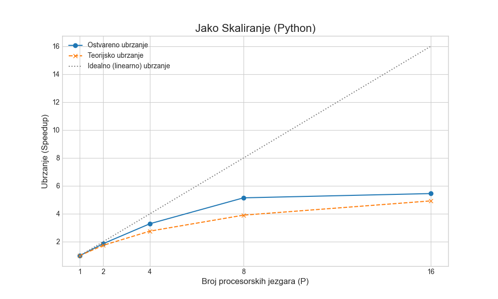
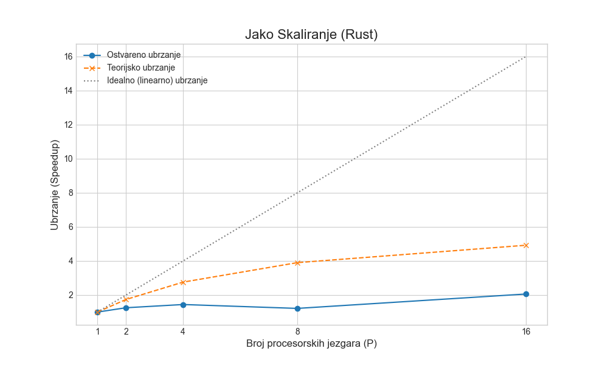
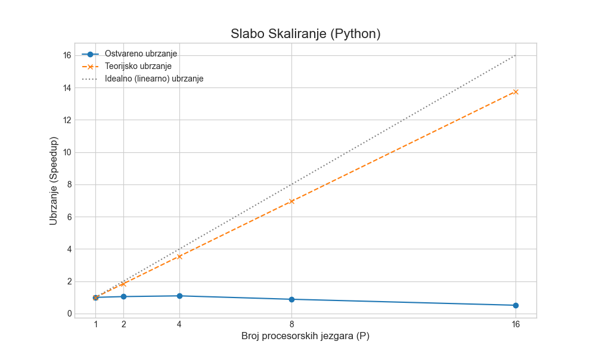
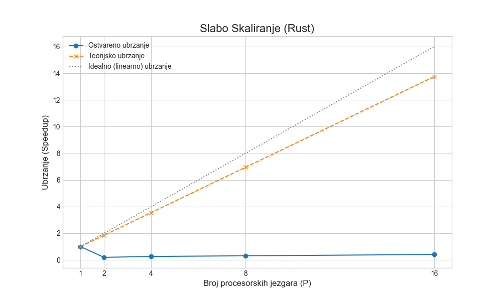

# N-body Problem

## 1. Problem Description

This project solves the **n-body problem**: simulating a dynamic system of particles (bodies) that interact with each other through physical forces, most commonly gravity. The goal of the simulation is to predict the motion, i.e. the trajectories, of these bodies over time from their initial positions, masses and velocities.

Every body in the system attracts every other body with a force defined by Newton's law of universal gravitation:
$$ F = G \frac{m_1 m_2}{r^2} $$
where $m_1$ and $m_2$ are the masses of the two bodies, $r$ is the distance between them, and $G$ is the gravitational constant.

The computational complexity of calculating the forces in each time step is $O(n^2)$, because the interaction has to be computed for every pair of bodies. This makes the problem computationally intensive and an ideal candidate for parallelisation.

The simulation runs as an iterative process in discrete time steps ($\Delta t$). In each step, the state of the system is updated using **Euler integration**:

1.  **Force calculation:** For every body $i$, the total force $\vec{F_i}$ is computed. The force between two bodies follows Newton's law, with a **softening factor ($\epsilon$)** added to the denominator to avoid numerical instability (division by zero) when two bodies get too close:
    $$ \vec{F}_{ij} = G \frac{m_i m_j}{|\vec{r}_{ij}|^2 + \epsilon^2} \cdot \frac{\vec{r}_{ij}}{|\vec{r}_{ij}|} $$

2.  **Velocity update:** From the total force $\vec{F_i}$ and Newton's second law ($\vec{a_i} = \vec{F_i} / m_i$), the new velocity is computed:
    $$ \vec{v}_{i, new} = \vec{v}_{i, old} + \vec{a_i} \cdot \Delta t $$

3.  **Position update:** The new position of the body is determined from its new velocity:
    $$ \vec{p}_{i, new} = \vec{p}_{i, old} + \vec{v}_{i, new} \cdot \Delta t $$

This cycle repeats for a defined number of steps, and the positions of the bodies are written to an output CSV file for later analysis and visualisation.

## 2. Approach

The project is implemented in several parts:

* **Parallelisation in Python:** Using the `multiprocessing` library to parallelise across multiple CPU cores. The main focus is parallelising the force-calculation loop.
* **Parallelisation in Rust:** Using threads to achieve parallelism.
* **Performance analysis:** **Strong- and weak-scaling** experiments for both implementations (Python and Rust) to measure the speedup and efficiency of the parallel solutions.
* **Visualisation:** A 2D visualisation of the simulation in Rust (using a library such as `Plotters`) based on the data generated during the simulation.

## 3. Parallelisation

The most computationally intensive part of the algorithm is the **force calculation**, with complexity **$O(N^2)$**, and it is the main bottleneck.

### Parallelisation in Python

The **Python parallelisation strategy** is implemented as follows:
* A `multiprocessing.Pool` creates a group of worker processes, whose count can be controlled through the `--cores` command-line argument.
* In each simulation step, `functools.partial` creates a temporary worker function (`worker_func`) that knows the current positions and masses of all bodies.
* The main function then distributes the work with `pool.map`, calling `worker_func` for every body in the system and spreading the force calculation across all available cores.
* Once all processes finish, the main process collects the results and continues with the sequential update of velocities and positions.

### Parallelisation in Rust

The **Rust parallelisation strategy** is implemented as follows:
* The **Rayon** library and its work-stealing thread pool are used, with the number of threads controlled through the `--cores` command-line argument.
* In each simulation step, calling `par_iter()` on the vector of bodies turns the sequential iterator into a parallel one, preparing the system to distribute the work.
* Rayon then distributes the work by executing a `map()` operation (closure) for every body in parallel, computing the total force on that body.
* Once all threads finish their computation, `collect()` gathers the results into a single vector of forces, after which the sequential update of velocities and positions continues.

## 4. Experiments and Performance Analysis

To quantify the speedup gained from parallelisation, two standard types of experiments are run for both implementations (Python and Rust).

### Strong Scaling Experiment
* **Goal:** Measure the speedup when solving a problem of **fixed size**.
* **Method:** The number of bodies in the simulation is fixed (e.g. $N=100$). The program is run with a progressively larger number of cores (1, 2, 4, 8, ...), and the execution time is measured for each configuration.
* **Analysis:** The measured speedup ($Speedup = T_1 / T_P$, where $T_P$ is the time with $P$ cores) is compared with the theoretical speedup predicted by **Amdahl's law**.

### Weak Scaling Experiment
* **Goal:** Measure the system's ability to solve an **ever larger problem** in the same amount of time as more processors are added.
* **Method:** The load per processor core is kept constant. Since the problem complexity grows as $O(N^2)$, when the number of cores ($P$) increases, the number of bodies ($N$) is increased by a factor of $\sqrt{P}$.
* **Analysis:** Efficiency and speedup are compared with the theoretical model defined by **Gustafson's law**.

## 5. Results

All measurements are averages of three runs on the same machine; raw data is in the `*_results.csv` files and the summary tables in `*_table_*.csv`. Plots are generated with `generate_graphs.py` and tables with `generate_tables.py`.

### Strong scaling (N = 100 bodies, 1–16 cores)

| Cores | Python time (s) | Python speedup | Rust time (s) | Rust speedup | Amdahl prediction |
|---|---|---|---|---|---|
| 1 | 55.8 | 1.00× | 28.3 | 1.00× | 1.00× |
| 2 | 30.0 | 1.86× | 22.5 | 1.25× | 1.74× |
| 4 | 17.0 | 3.29× | 19.6 | 1.44× | 2.76× |
| 8 | 10.8 | 5.14× | 23.3 | 1.22× | 3.90× |
| 16 | 10.2 | 5.45× | 13.7 | 2.06× | 4.92× |

The Python implementation scales well and exceeds the Amdahl prediction up to 16 cores, because the sequential baseline is dominated by the interpreted force loop, which parallelises almost perfectly across processes. The Rust implementation is already about twice as fast single-threaded, so the serial fraction (velocity and position updates, CSV output, per-step `par_iter` scheduling) weighs much more. With only 100 bodies the work per step is too small for Rayon's thread pool to amortise its overhead, which is why Rust's speedup is modest and non-monotonic, and why its standard deviation is high.

### Weak scaling (N grows with √P, 1–16 cores)

| Cores | Bodies | Python time (s) | Python efficiency | Rust time (s) | Rust efficiency |
|---|---|---|---|---|---|
| 1 | 20 | 2.87 | 1.00 | 1.10 | 1.00 |
| 2 | 40 | 5.47 | 0.52 | 11.40 | 0.10 |
| 4 | 80 | 10.49 | 0.27 | 16.79 | 0.07 |
| 8 | 160 | 26.00 | 0.11 | 28.42 | 0.04 |
| 16 | 320 | 89.64 | 0.03 | 43.26 | 0.03 |

Weak-scaling efficiency drops sharply for both implementations. Scaling N by √P keeps the number of pair interactions per core constant, but each worker still has to read the positions of all N bodies every step, so the per-core work grows with N rather than staying flat, and the sequential update phase grows linearly with N. The result is far from the ideal predicted by Gustafson's law and shows that the simple "one body per task" decomposition does not hold up as the problem grows.
